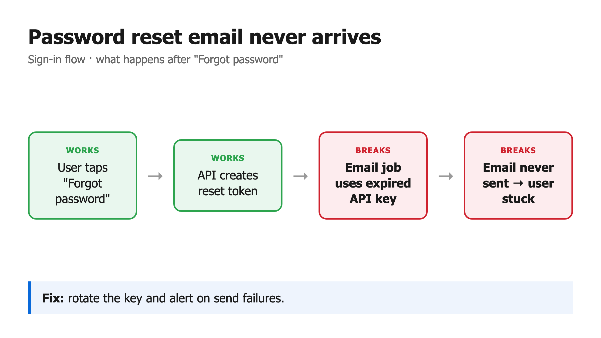

# short-visual-answers

A Claude skill that makes answers **short, direct and visual**: verdict first, tables with evidence, and a diagram or PNG card instead of a wall of text.



## Why

It was built from about 280 real requests one developer kept repeating to Claude over six months: *"short answer"*, *"explain it simply"*, *"in a diagram"*, *"use a table"*, *"show the evidence"*, *"not AI-sounding"*. The skill turns that feedback into rules, so you don't have to ask again.

| Without the skill | With the skill |
|---|---|
| "You're right. Let me restate it properly…" + 4 sections | Answer in line 1, ≤ 5 lines |
| Paragraphs about how it was checked | A table with an **Evidence** column |
| Long text to explain a flow | A diagram or PNG card, green = works, red = breaks |
| "I don't understand" → even more detail | One concrete example + one picture |
| AI-sounding Slack drafts | 3 lines in your own voice |

## What's inside

```
skills/short-visual-answers/
├── SKILL.md              # the 9 rules + pictures, drafts, artifacts, status
├── card-template.html    # one-idea card, edit the text
├── scripts/card.sh       # HTML -> 2x PNG with headless Chrome/Chromium/Edge
└── references/voice.md   # optional: your own writing style for drafts
```

## Install

### Option 1: Claude Code plugin

```
/plugin marketplace add mohamedelkadi/short-visual-answers
/plugin install short-visual-answers@short-visual-answers
```

### Option 2: install script (adds auto-load)

```bash
git clone https://github.com/mohamedelkadi/short-visual-answers.git
cd short-visual-answers
./install.sh --auto-load
```

| Command | Effect |
|---|---|
| `./install.sh` | Skill in `~/.claude/skills` (all projects) |
| `./install.sh --project ~/code/app` | Skill only for that project |
| `--auto-load` | Adds one line to `CLAUDE.md` so it applies to every reply |
| `./install.sh --uninstall` | Removes the skill and the auto-load line |

### Option 3: claude.ai / Claude desktop

Zip the `skills/short-visual-answers` folder and upload it under **Settings → Capabilities → Skills**.

## Make it always on

Claude loads a skill when its description matches the request. To apply it to **every** reply, add this to `~/.claude/CLAUDE.md` (the install script's `--auto-load` does it for you):

```
Before any reply that explains, summarizes, reports status, compares options, drafts text for others, or builds an artifact, load the `short-visual-answers` skill and follow it.
```

## Make it sound like you

Edit `references/voice.md` and paste 3–5 messages you wrote and liked. Drafts for Slack, Jira, email and PR comments will follow that style. Re-running `install.sh` keeps your edited file.

## PNG cards

Requires Chrome, Chromium, Edge or Brave (or set `CHROME=/path/to/browser`).

```bash
cp skills/short-visual-answers/card-template.html my-card.html   # edit the text
skills/short-visual-answers/scripts/card.sh my-card.html my-card.png
```

## Use it

You don't need special prompts. These all trigger it:

- "why is the build failing? short answer"
- "explain this flow simply"
- "give me a table of the open PRs with evidence"
- "draft a slack reply to the team"
- "make a card I can share with QA"
- "create an artifact explaining the bug"

## License

MIT
